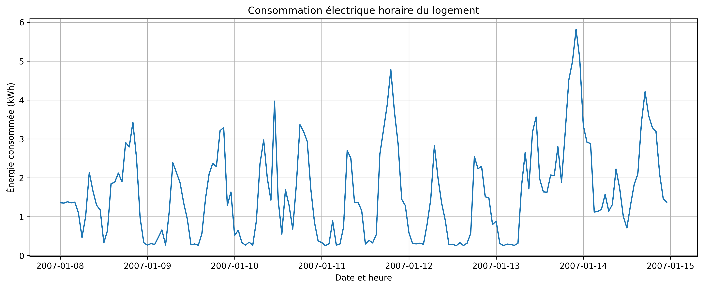
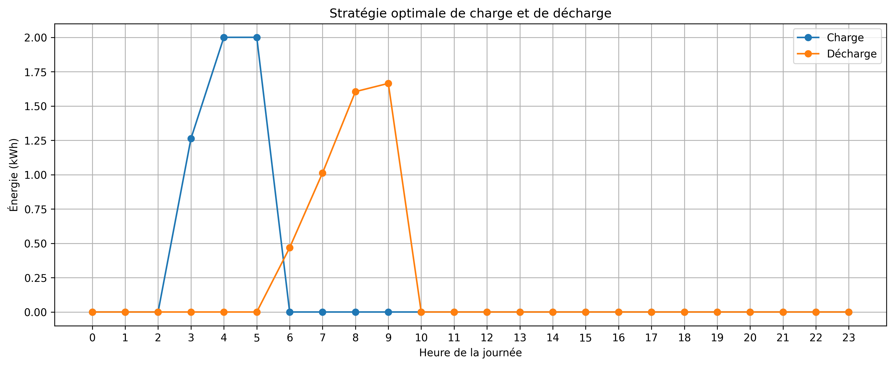
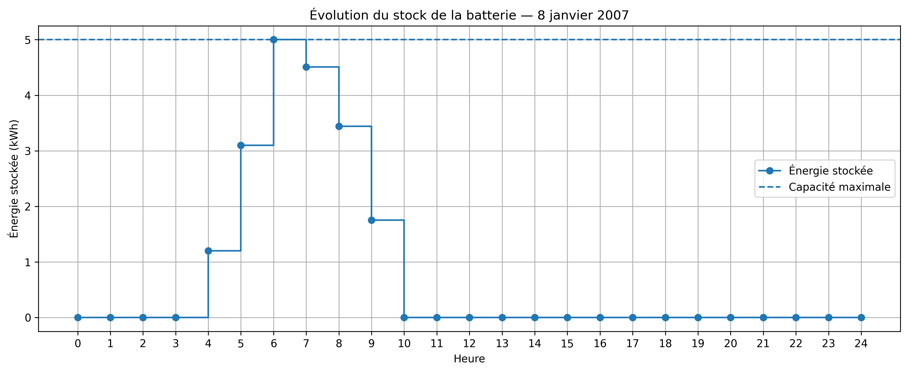

# Optimisation du coût de l'électricité avec stockage sur batterie

## Présentation

Ce projet personnel porte sur l'optimisation de la consommation électrique d'un logement équipé d'une batterie de stockage.

L'idée est de déterminer quand charger et décharger la batterie pour réduire le coût de l'électricité achetée au réseau, en tenant compte des tarifs horaires et des contraintes de fonctionnement de la batterie.

Le projet combine l'analyse de données de consommation, la modélisation mathématique et l'optimisation linéaire en Python.

## Problématique

Avec une tarification heures pleines/heures creuses, le prix de l'électricité dépend du moment où elle est achetée.

Une batterie peut être chargée pendant les heures creuses, puis utilisée pour alimenter le logement pendant les heures pleines.

La question étudiée est donc :

**Comment minimiser le coût de l'électricité sur une période donnée en optimisant la charge et la décharge d'une batterie ?**

Le modèle doit respecter plusieurs contraintes : capacité de stockage, puissance maximale, rendements énergétiques et absence de revente d'électricité au réseau.

## Données utilisées

Le projet utilise le jeu de données `Individual household electric power consumption`, contenant des mesures historiques de consommation électrique d'un logement.

Pour cette première simulation, la période retenue est celle du 8 au 14 janvier 2007.

Les données sont initialement enregistrées toutes les minutes. Après nettoyage, traitement d'une valeur manquante et agrégation horaire, on obtient 168 valeurs de consommation énergétique.

Les données sont utilisées avec un scénario tarifaire simulé :

| Période | Prix |
|---|---:|
| Heures creuses (22 h – 6 h) | 0,1589 €/kWh |
| Heures pleines (6 h – 22 h) | 0,2142 €/kWh |

Ces tarifs sont des hypothèses de simulation et ne correspondent pas nécessairement aux prix historiques de janvier 2007.

## Modèle d'optimisation

Le problème est formulé comme un programme linéaire et résolu avec `scipy.optimize.linprog`, en utilisant le solveur HiGHS.

À chaque heure, le modèle détermine :

- L'énergie utilisée pour charger la batterie.
- L'énergie fournie par la batterie au logement.
- L'énergie restante dans la batterie.

Les paramètres de la première simulation sont :

| Paramètre | Valeur |
|---|---:|
| Capacité de la batterie | 5 kWh |
| Puissance maximale | 2 kW |
| Rendement de charge | 95 % |
| Rendement de décharge | 95 % |
| Stock initial et final | 0 kWh |

L'optimisation suppose que les consommations et les tarifs de la semaine sont connus à l'avance.

La formulation mathématique complète est disponible dans [docs/modelisation.md](docs/modelisation.md).

## Premiers résultats

La première optimisation a été réalisée sur 168 heures consécutives.

| Indicateur | Résultat |
|---|---:|
| Coût sans batterie | 54,63 € |
| Coût avec batterie | 53,36 € |
| Économie sur 7 jours | 1,27 € |
| Réduction relative | 2,32 % |

Avec les hypothèses retenues, la batterie permet donc une économie de 2,32 % sur la semaine étudiée.

L'économie reste modeste, notamment en raison de l'écart tarifaire limité et des pertes énergétiques de la batterie.

Ces résultats ne tiennent pas compte du prix d'achat, de l'installation ni du vieillissement de la batterie.

### Consommation horaire



### Stratégie de charge et de décharge



Sur la première journée, la batterie se charge principalement pendant les heures creuses, puis se décharge le matin après le passage en heures pleines.

### Évolution du stock



Le stock reste compris entre 0 et 5 kWh, conformément aux contraintes imposées.

Une analyse plus détaillée des résultats est disponible dans [docs/resultats.md](docs/resultats.md).

## Technologies utilisées

- Python
- NumPy et Pandas
- SciPy (optimisation linéaire)
- Matplotlib
- Git et GitHub

## Organisation du projet

```text
Projet_Perso/
├── data/
│   └── household_power_consumption.csv
├── src/
│   ├── analyse_donnees.py
│   └── optimisation.py
├── docs/
│   ├── modelisation.md
│   └── resultats.md
├── figures/
│   ├── consommation_horaire.png
│   ├── strategie_batterie.png
│   └── evolution_stock.png
├── .gitignore
└── README.md
```

Le fichier CSV est conservé localement et n'est pas inclus dans le dépôt GitHub en raison de sa taille.

## Exécution

Installer les bibliothèques nécessaires :

```bash
pip install numpy pandas scipy matplotlib
```

Télécharger le jeu de données `Individual household electric power consumption` depuis l'UCI Machine Learning Repository.

Placer le fichier de consommation dans le dossier `data/` sous le nom :

`household_power_consumption.csv`

Depuis la racine du projet, exécuter :

```bash
python src/analyse_donnees.py
python src/optimisation.py
```

Les résultats sont affichés dans le terminal et les graphiques sont enregistrés dans le dossier `figures/`.

## État d'avancement

### Réalisé

- [x] Définition du problème et des hypothèses.
- [x] Formulation mathématique du modèle.
- [x] Chargement et prétraitement des données.
- [x] Construction du scénario tarifaire.
- [x] Implémentation de l'optimisation linéaire.
- [x] Comparaison économique avec et sans batterie.
- [x] Vérification initiale des contraintes.
- [x] Visualisation de la consommation et de la stratégie optimale.

### À poursuivre

- [ ] Analyse de sensibilité sur la capacité de la batterie.
- [ ] Étude de l'influence des rendements et des tarifs.
- [ ] Comparaison de plusieurs scénarios énergétiques.
- [ ] Évaluation de la rentabilité en tenant compte du coût de la batterie.

## Perspectives

Une extension possible serait d'introduire une prévision de consommation par apprentissage automatique, afin de ne plus supposer que toute la consommation future est connue à l'avance.

Le modèle pourrait également être adapté à une optimisation sous incertitude, avec des consommations ou des prix prévisionnels.
