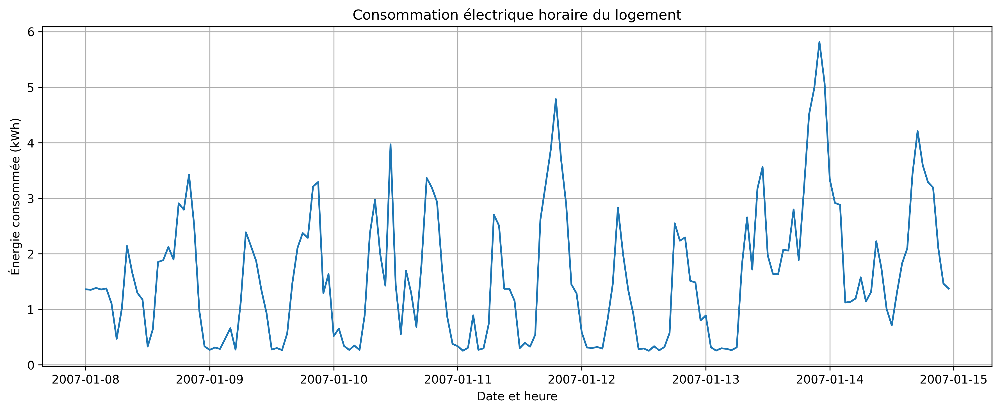
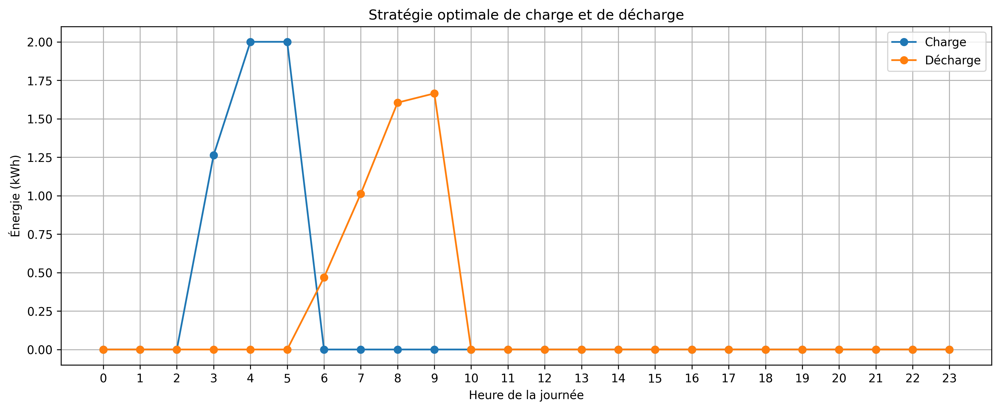
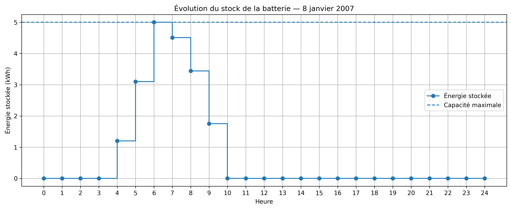

# Projet personnel — Analyse et résultats

## 1. Données et prétraitement

### 1.1 Jeu de données

Le projet utilise le fichier `household_power_consumption.csv`, qui contient des mesures historiques de consommation électrique d'un logement.

Pour cette première étude, j'ai sélectionné la semaine du 8 au 14 janvier 2007, soit sept jours consécutifs.

Les mesures sont initialement enregistrées toutes les minutes. Le prétraitement permet de construire une série de consommation horaire utilisable pour l'optimisation.

### 1.2 Prétraitement

Les données ont été traitées avec Python et Pandas :

- Lecture du fichier CSV et conversion des dates.
- Sélection de la semaine étudiée.
- Identification d'une valeur manquante.
- Remplacement de cette valeur par interpolation linéaire.
- Conversion des puissances (kW) en énergies (kWh).
- Agrégation des mesures à un pas horaire.

Pour chaque mesure d'une minute, l'énergie consommée est calculée par :

$$
E_{\mathrm{minute}} = \frac{P_{\mathrm{minute}}}{60}
$$

Les énergies obtenues sont ensuite additionnées pour chaque heure.

### 1.3 Résultats du prétraitement

| Indicateur | Résultat |
|---|---|
| Période étudiée | 8–14 janvier 2007 |
| Nombre de mesures | 10 080 |
| Fréquence initiale | 1 minute |
| Valeurs manquantes | 1 |
| Traitement | Interpolation linéaire |
| Fréquence finale | 1 heure |
| Nombre de valeurs horaires | 168 |

### 1.4 Consommation horaire

La consommation varie au cours de la semaine, avec plusieurs pics observés en fin de journée. Ces pics ne sont cependant pas présents tous les jours.

Après prétraitement, on obtient 168 valeurs horaires de consommation, utilisées comme données d'entrée du programme d'optimisation.

## 2. Coût de référence sans batterie

Avant d'introduire la batterie, j'ai calculé le coût de l'électricité consommée sur la semaine étudiée.

### 2.1 Hypothèses tarifaires

Le modèle utilise une tarification heures pleines/heures creuses :

| Période | Horaires | Prix |
|---|---|---|
| Heures creuses | 22 h – 6 h | 0,1589 €/kWh |
| Heures pleines | 6 h – 22 h | 0,2142 €/kWh |

Ces prix sont des hypothèses de simulation et ne représentent pas nécessairement les tarifs appliqués en janvier 2007.

Le coût de référence est calculé par :

$$
C_{\mathrm{ref}} = \sum_{t=0}^{167} p_t D_t
$$

où :

- `p_t` représente le prix de l'électricité à l'heure t, en €/kWh.
- `D_t` représente l'énergie consommée pendant l'heure t, en kWh.

**Coût sans batterie sur sept jours : 54,63 €.**

Ce montant sert de référence pour mesurer les économies obtenues avec la batterie.

## 3. Optimisation de la batterie

### 3.1 Modèle utilisé

Le problème a été formulé comme un programme linéaire, puis résolu avec `scipy.optimize.linprog` et le solveur HiGHS.

L'optimisation porte sur les 168 heures de la semaine, en supposant que les consommations et les tarifs sont connus à l'avance.

Les paramètres retenus pour cette première simulation sont :

| Paramètre | Valeur |
|---|---|
| Capacité de la batterie | 5 kWh |
| Puissance maximale de charge | 2 kW |
| Puissance maximale de décharge | 2 kW |
| Rendement de charge | 95 % |
| Rendement de décharge | 95 % |
| Stock initial | 0 kWh |
| Stock final | 0 kWh |

Le détail de la formulation mathématique et des contraintes est présenté dans [modelisation.md](modelisation.md).

### 3.2 Résultats économiques

| Indicateur | Résultat |
|---|---:|
| Coût sans batterie | 54,63 € |
| Coût avec batterie | 53,36 € |
| Économie sur sept jours | 1,27 € |
| Réduction relative | 2,32 % |

Avec les paramètres choisis, l'utilisation de la batterie permet de réduire le coût de l'électricité de 2,32 % sur la semaine étudiée.

L'économie reste relativement faible. L'écart entre les tarifs heures pleines et heures creuses, ainsi que les pertes liées aux rendements, limitent l'intérêt économique du stockage dans ce scénario.

Ces résultats concernent uniquement le coût de l'électricité achetée au réseau. Ils ne prennent pas en compte le prix d'achat de la batterie, son installation ou son vieillissement.

### 3.3 Vérification des contraintes

Après résolution, les points suivants ont été vérifiés :

- Le stock reste compris entre 0 et 5 kWh.
- Le stock initial et le stock final sont nuls.
- L'énergie achetée au réseau reste positive ou nulle, à la tolérance numérique près.
- Aucune charge et décharge simultanées n'ont été détectées dans la solution obtenue.

La formulation linéaire n'interdit pas directement la charge et la décharge simultanées. Cette dernière vérification concerne donc uniquement la solution calculée.

## 4. Analyse de la stratégie optimale

### 4.1 Charge et décharge sur la première journée

Le graphique suivant présente les décisions de charge et de décharge obtenues pour le 8 janvier 2007.

On observe que la batterie se charge principalement entre 3 h et 5 h, pendant les heures creuses, puis se décharge entre 6 h et 9 h, pendant les heures pleines.

Le modèle cherche donc à acheter davantage d'électricité lorsque le prix est faible, afin de réduire les achats lorsque le prix augmente.

Un point intéressant est que la batterie se décharge surtout le matin, alors que certains pics de consommation apparaissent en soirée.

Cela s'explique notamment par notre hypothèse tarifaire : le prix de l'électricité reste identique entre 6 h et 22 h.

Il n'y a donc pas d'avantage tarifaire direct à attendre le soir plutôt qu'à décharger le matin. La solution obtenue choisit principalement le matin, mais d'autres répartitions peuvent éventuellement conduire au même coût.

### 4.2 Évolution du stock

Le graphique ci-dessous représente l'évolution de l'énergie stockée dans la batterie pendant la première journée.

Le stock augmente pendant la phase de charge, puis diminue lorsque la batterie fournit de l'énergie au logement.

La capacité maximale de 5 kWh est respectée tout au long de la simulation.

## 5. Limites et prochaines étapes

Cette première version permet d'étudier une stratégie de stockage à partir de données réelles de consommation électrique.

Les résultats dépendent cependant des hypothèses choisies, notamment des tarifs et des caractéristiques de la batterie.

La prochaine étape consistera à étudier l'influence de plusieurs paramètres :

- **Capacité de la batterie :** comparer différentes capacités pour mesurer leur influence sur les économies.
- **Rendements :** évaluer l'effet des pertes énergétiques sur le coût optimisé.
- **Écart tarifaire :** déterminer dans quelles conditions le stockage devient plus intéressant.
- **Puissance maximale :** étudier son influence sur les décisions de charge et de décharge.

À plus long terme, il serait intéressant d'intégrer le coût d'acquisition et la dégradation de la batterie pour étudier sa rentabilité économique.

Pour l'instant, les 1,27 € d'économies hebdomadaires constituent un premier résultat de simulation, et non une estimation de rentabilité réelle.
